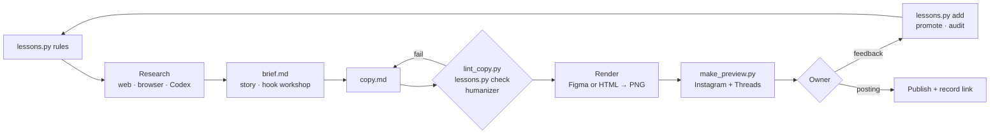

<div align="center">

# kilas-content

**Agent skills that plan, write, design, check, and preview a brand's social content.**

Monthly plans · Instagram carousels · Reels scripts and animated videos · Threads · X · LinkedIn
Built for Claude Code, Codex, and any agent that reads `SKILL.md`.

[](LICENSE)
[](https://github.com/vercel-labs/skills)


</div>

---

## Why

Most "AI content" fails the same way: generic tips, stiff copy, a look that does not match
the brand, and numbers nobody checked. These skills put a method around the agent:
research first, a hook workshop, a lint for AI tells, a design system per brand, a preview
the owner can swipe, and a **lessons file that turns every piece of owner feedback into a
rule the next run must follow**.

## What's inside

| Skill | Job |
|---|---|
| [`kilas-content`](skills/kilas-content/) | Plans and creates the content. Every brand detail lives in a brand pack. |
| [`setup-content`](skills/setup-content/) | First run: reads the brand's site and profiles (with permission), collects its logo, colours, fonts, and photos, picks the renderer, writes the brand pack. |

## Features

- 🗓️ **Plans that hold up.** Pillars with shares, series, a calendar per month, and a checker
  (`check_plan.py`) that flags drift. Product brands get a demo-first rule and one storyline
  per month.
- ✍️ **Copy that reads like a person.** Five hooks in three shapes, gates and duels, then
  `lint_copy.py` for AI tells, banned phrases, and platform limits, plus a humanizer pass.
- 🎨 **On-brand frames.** Figma (via the Figma MCP) or HTML rendered to PNG with a slide kit
  and the brand's own schemes, fonts, logo, and mascot.
- 👀 **Owner preview.** `make_preview.py` builds a swipeable **Instagram** post mock and a
  **Threads** thread view (replies, attached slides) from an item folder. Open it locally or
  publish it as a Claude Artifact.
- 🧠 **Self-improvement loop.** `lessons.py` records owner feedback, review findings, and your
  own mistakes as rules (`content/lessons.md`), prints them before every run, fails a draft
  that breaks one, and audits that every rule reached its home (brand pack or skill).
  `skill_check.py` checks the skill itself (front matter, pointers, scripts), so a broken
  step is healed at its source.
- 🤝 **Second agent on call.** `ask_codex.sh` asks the Codex CLI for research, brainstorms,
  alternative copy, or a strict review, read-only and with a time limit; its answers are
  leads to check.
- 🔎 **Research tools.** Web search and fetch, a real signed-in browser for profiles,
  `x_post.py` for public X posts, and paid data catalogs such as Tapinall with a
  read-the-first-charge rule.
- 🖼️ **Images.** The brand's own photos first, then the agent's image tool or the Antigravity
  CLI (`agy`), then a paid API only if the owner allows it. Generated images are labelled.
- 🎬 **Reels videos with characters.** A live character animatic the owner approves first,
  then an ElevenLabs voice-over per beat (`vo_elevenlabs.py`, with a transcript check and a
  measured check that English acronyms sound English, `vo_acronym_check.py`), a HyperFrames
  render, and a check of the MP4 itself (`reel_qa.py`). Reusable rig in `templates/video/`;
  3D explainers in three.js from a working template (`templates/video3d/`: a 60 s scene, a
  mascot rig with faces and gestures, a pose sheet; `new_scene3d.sh` starts one,
  `scene3d_video.py` adds the voice-over for the render), with stills straight from the
  scene (`scene_stills.sh`) and a worked example step by step; companion skills listed in
  `references/motion-video.md`.

## Quick start

```bash
# both skills, for the agents the CLI detects
npx skills add kilaslab/kilas-content --skill kilas-content --skill setup-content

# global, one agent
npx skills add kilaslab/kilas-content --skill kilas-content --skill setup-content -g -a claude-code
```

Or copy `skills/kilas-content/` and `skills/setup-content/` side by side into your agent's
skills folder (`.claude/skills/`, `.agents/skills/`, `~/.grok/skills/`, ...). Keeping the real
files in `.agents/skills/` with symlinks in `.claude/skills/` lets Claude Code and Codex share
one copy.

Then talk to your agent:

```text
setup content untuk brand kami: <website>, instagram <link>
rencana konten bulan ini
bikin carousel dari artikel ini <link>
kritisi kalender ini sekali lagi
```

## How a piece is made



Nothing is posted, liked, or followed without the owner's explicit go for that piece.

## Scripts at a glance

| Script | What it does |
|---|---|
| `new_item.py` | Item folder from the templates |
| `lint_copy.py` | AI tells, language slips, platform limits, banned phrases |
| `lessons.py` | `rules` · `check` · `add` · `audit`: the self-improvement loop |
| `skill_check.py` | The skill itself: front matter, every pointer, every script listed and parsing |
| `check_plan.py` | A month plan against the brand pack |
| `ask_codex.sh` | Codex research, brainstorm, copy, or review (read-only, `CODEX_TIMEOUT`) |
| `new_html.py` · `render_slides.py` | HTML slide kit and PNG render with a layout check |
| `make_preview.py` | Instagram + Threads preview for the owner |
| `gen_image.py` | Images via agy or an allowed API key, with credits |
| `crawl_site.py` · `capture_profile.sh` | The brand's own assets from its site and profiles |

The full map is in [`skills/kilas-content/README.md`](skills/kilas-content/README.md).

## Requirements

Python 3.9+. Detected at run time and optional: the Figma MCP, Python Playwright or
Chrome/Chromium, web search and fetch, `ego-browser`, the Codex CLI, `agy`, image API keys.
Companion skills (`copywriting`, `social`, `humanizer`, `bahasa-indonesia`) are listed in
[`prerequisites.md`](skills/kilas-content/references/prerequisites.md).

## Contributing

Issues and pull requests are welcome. Keep the skill brand-agnostic: brand details belong in
a brand pack, never in `SKILL.md` or the references.
`skills/kilas-content/scripts/export_oss.sh` fails if a private brand name slips into an
exported copy. When you add a rule that came from real use, say where it came from.

## License

Copyright (C) 2026 Kilaslab

GPL-3.0-or-later: see [LICENSE](LICENSE). You may use, study, change, and share these
skills; copies and modified versions you distribute must stay under the GPL and ship their
source.
